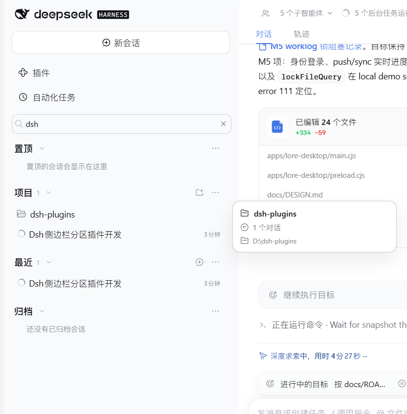

# dsh-sidebar-sections

[简体中文](README.md) | English

A [DeepSeek Harness](https://github.com/deepseek-ai/deepseek-harness) Web UI plugin that turns the
sidebar into a **Pinned / Projects / Recent / Archived** conversation browser — with per-section
menus, drag ordering, context menus, safe delete, plugin settings and file-manager shortcuts.




*Image notes: left is the four-section Pinned / Projects / Recent / Archived sidebar; middle is the section menu for grouping and ordering; right is the project menu with reveal, rename and delete actions. The screenshot reflects the current 2.3.0 version.*

## Table of contents

- [Why](#why)
- [Features](#features)
- [Install](#install)
- [Usage](#usage)
- [Architecture](#architecture)
- [Compatibility](#compatibility)
- [Development](#development)
- [Testing](#testing)
- [Troubleshooting](#troubleshooting)
- [Known limitations](#known-limitations)
- [Contributing](#contributing)
- [License](#license)

## Why

The shipped browser groups conversations inside Workspaces and gives archived conversations a
toggleable view. Long-lived projects end up needing the same conversations in several places:
something pinned on top, the project tree intact, a chronological catch-all, and a place for the
archive.

`dsh-sidebar-sections` keeps the shipped management surface — it only changes the layout:

- **Pinned** and **Archived** are first-class sections instead of hidden filters.
- **Projects** keeps the editable Workspace groups, but grouping and sort are configurable per
  section and per project.
- **Recent** is a flat, unbounded-by-history chronological view.
- Every management action (pin, archive, rename, fork, copy Session ID, order changes) still goes
  through the Host — nothing important lives only in plugin memory.

## Features

### Sections

| Section | Contents |
|---|---|
| **Pinned** | Host pin set, newest pin first. Rows keep the shipped conversation UI and a resting 📌 marker. |
| **Projects** | One group per registered Workspace. Groups collapse (remembered browser-locally) and show the project folder icon. Each project can be sorted independently. |
| **Recent** | Unpinned conversations, newest activity first (8 rows, then *Show more* in steps of 20). Optionally grouped by project. |
| **Archived** | Every archived conversation, grayed out and not openable until restored; can be hidden from plugin settings; empty hint. |

Each header is a large bold row with a collapse chevron and right-side actions; the `⋯` button is
always the rightmost action so the menus line up across sections.

### Conversations

- Hover or keyboard-focus a row to reveal **archive/unarchive**, **pin/unpin**, and the **⋯** row
  menu (pin/unpin, rename, fork, archive/unarchive, copy Session ID).
- **Right-click** or press the Context Menu key / `Shift+F10` for the same menu at the pointer or
  focused row.
- Hovering a row for ~400 ms shows a preview card with the title, owning project and time. The
  pointer can travel into the card; the card closes only after leaving both the row and the card.
- Archived rows expose **Unarchive** and **Delete conversation (safe)** instead of pin/archive and cannot be opened.

### Ordering

| Choice | Scope |
|---|---|
| **Manual order** | Drag rows inside the section/project. Drops before/after the target show an insertion line; the list auto-scrolls near its edges. |
| **Last updated** | Read-only chronological order. |
| **By project / In one list** | Projects and Recent grouping modes. |

- Orders are saved browser-locally and survive reloads.
- Real Workspace groups also persist row order to the Host through
  `workspaces.insertSessionBefore`; a rejected write shows an inline notice.
- Per-project menus offer **Use section order / Manual order / Last updated** and can reset to the
  section default.
- Dragging is disabled for blank drafts, across groups, and while a filter is active.

### Context menus and keyboard

- Right-click a conversation row, project row, or any section heading.
- Keyboard: `Context Menu` or `Shift+F10` opens the menu; `Enter`/`Space` still activates the row,
  `Tab` reaches row actions, `Escape` closes menus and the filter.

### Plugin settings and safe delete

Open **Settings → Built-in plugins → Sidebar sections**:

- **Show Archived section** — hide or restore the Archived section. Archived conversations remain in
  the Host while hidden.
- **Removed conversations** — safely deleted conversations are listed here and can be restored in
  one click.

Safe delete is available from an archived row's context menu or `⋯` menu. A confirmation dialog
precedes it. The operation removes the conversation from every sidebar section and stores a
restorable browser-local tombstone; it does not call a Host delete API and does not alter the session
record on disk. Restoring puts the conversation back in its original section.

### Search and view state

- Full-width search row filters loaded conversations by title, project name or directory basename;
  matching groups auto-expand; `Esc` clears and collapses it.
- Everything view-related is stored in `localStorage` under `dsh.sidebarSections.*`: collapse
  state, grouping/sort, per-project sort overrides, drag order, Archived visibility and the
  safe-delete list. Host data (pin/archive sets, session titles) is never duplicated locally.

## Install

### Plugin Manager (recommended)

From a Creator-preset session:

```text
plugin_manager(action="install_bundle", target="<absolute path to this directory>")
```

The Plugin Manager writes the profile manifest, installs/link the bundle, selects it, and
recomposes the configuration. Installing into a running profile can activate through HMR; no
restart is required when it does.

> Notes: `install_bundle` is only available in a Creator-preset session, needs Full access (or
> approval for the call), and `target` must be an absolute path. If the current profile already
> has the same package installed (for example from an earlier manual link), it answers
> `already-installed`; run `remove_bundle` first, or keep using the manual install for development.

### Manual install (development)

1. Make the package resolvable from the profile:

   ```powershell
   $profile = "$env:USERPROFILE\.dsh\profiles\desktop"
   New-Item -ItemType Directory -Force -Path "$profile\node_modules" | Out-Null
   New-Item -ItemType Junction -Path "$profile\node_modules\dsh-sidebar-sections" `
            -Target "<absolute path to this directory>"
   ```

2. In one atomic write, add the `link:` dependency **and** append the bundle to
   `dsh.profile.bundles` in the profile's `package.json`:

   ```json
   {
     "dependencies": {
       "dsh-sidebar-sections": "link:<absolute path to this directory>"
     },
     "dsh": {
       "profile": {
         "bundles": ["…existing bundles…", "dsh-sidebar-sections"]
       }
     }
   }
   ```

   Only the ordered bundle list triggers live recomposition; dependency-only edits are ignored by
   the profile watcher.

3. The running app applies the change after ~2 s. `client.js` edits then hot-update the browser
   mount through client HMR (~0.5 s).

### Uninstall

Remove `dsh-sidebar-sections` from `dsh.profile.bundles` (the shipped browser returns immediately),
then remove the dependency and the junction. With the Plugin Manager this is `remove_bundle`.

### Requirements

- DeepSeek Harness `0.2.1-rc.2` (Web or Desktop Web surface).
- No build step, no package install, no runtime dependencies.

## Usage

1. **Pin a conversation** — hover a row and press the pin button. It moves to **Pinned** and leaves
   its project group and **Recent**; unpinning restores all three.
2. **Archive a conversation** — use the row's archive button or menu. It moves to **Archived**;
   restore it with **Unarchive** there. Running work asks for the shipped stop-and-archive
   confirmation.
3. **Sort and group** — open a section's `⋯` menu. Pinned/Archived only offer order; Projects/Recent
   offer grouping and order; each project row's `⋯` menu adds a project-level override.
4. **Reorder manually** — choose Manual order, then drag rows. Project-level manual order applies
   even when the section itself is on Last updated.
5. **Open a project folder** — right-click a project row (or use its `⋯` menu) and choose
   **Open in File Manager**.
6. **Find** — type in the search row. Matching groups expand; `Esc` closes.
7. **Open a menu without the mouse** — focus a row/project/heading and press `Shift+F10`.
8. **Inspect before opening** — hover a conversation or project row; the preview card appears after
   ~400 ms and disappears when the pointer leaves.

## Architecture

`sidebar.workspaces` is a root-scoped `single` slot declared by `ui-sidebar`. The shipped
`@deepseek-ai/dsh-client-ui-workspace` browser registers there at the default priority `0`; this
plugin registers at priority `-1`. The lowest live priority renders, so the replacement wins
regardless of load order. The losing registration stays on the ledger (and keeps owning its child
slot declarations), so this plugin **declares no children** and renders its own rows, menus, and
dialogs.

```
sidebar.workspaces (single, root)
├── @deepseek-ai/dsh-client-ui-workspace   priority  0   shipped browser
└── dsh-sidebar-sections                   priority -1   this plugin (renders)
```

```
ui-sidebar slot
   └─ Browser (client.js)
        ├─ deriveSections()  — pure snapshot → pinned / projects / recent / archived pools
        ├─ Browser state     — query, collapse, views, manual order, drag/hover/context UI state
        ├─ shell.overlay     — workspace rename/delete, session rename, stop-and-archive dialogs
        └─ uiWorkspace / workspaces / sessions   — all Host mutations
```

- **Reads** — `useSessions`, `useWorkspaces`, `useSessionStatus`, `usePanelInfo`, supplied by the
  slot renderer. The component never subscribes to stores directly.
- **Writes** — `ctx.get('uiWorkspace')` (`openSession`, `startSession`, `pinSession`,
  `unpinSession`, `archiveSession`, `unarchiveSession`, `forkSession`, `pickDirectory`),
  `ctx.get('workspaces')` (`create`, `rename`, `delete`, `insertSessionBefore`), and
  `ctx.get('sessions').using()` for session rename. Failures surface as inline notices.
- **Reuse** — icons, `StateDot`, `Menu`, `Tooltip`, `Button`, `Modal`, `writeClipboard`, and
  `relativeTime` come from the shared `ui-primitives` module; the plugin draws no artwork.
- **File manager** — project menus call `remote.session.openWorkspacePath({ path })`
  so the Host reveals the project directory in the OS file manager (entry hidden for Ungrouped).
- **Dialogs** — registered into the root `shell.overlay` list so they render above the frame
  instead of being clipped by the sidebar; the sidebar talks to them through one bare observable
  passed via a registration `inject` face.
- **Module format** — a classic script calling
  `window.__ModuleLoader__.load({ id: '<package name>', factory })`. The factory returns the Cordis
  plugin (`{ inject, apply }`); the Host half is a no-op `apply` whose only job is to give the
  package a Loader entry so the client registry discovers the browser bundle.

### Browser-local keys

| Key | Contents |
|---|---|
| `dsh.sidebarSections.collapsed` | Collapsed Workspace groups. |
| `dsh.sidebarSections.collapsedSections` | Collapsed Pinned/Projects/Recent/Archived sections. |
| `dsh.sidebarSections.sectionViews` | Per-section grouping + sort choices. |
| `dsh.sidebarSections.projectSorts` | Per-project sort overrides. |
| `dsh.sidebarSections.manualOrder` | Drag-created manual orders. |

## Compatibility

| Component | Version |
|---|---|
| DeepSeek Harness | `0.2.1-rc.2` (source tag `dsh-v0.2.1-rc.2`) |
| Client slot API | pre-stable; validated against the shipped `ui-slots` / `ui-workspace` / `ui-sidebar` contracts |
| Runtime | Node bundled with DSH Desktop/Web; no external dependencies |
| Platform | Web and Desktop Web surface (verified on Windows; no platform-specific code) |

Harness client APIs are explicitly pre-stable. After a DSH upgrade, rerun
`node scripts/check.mjs` and re-check the live UI; a changed slot contract may require an update.

## Development

This plugin is one package inside the `dsh-plugins` monorepo. The root owns shared
CI, editor settings and the development installer; this package owns its manifest,
bundle, tests, docs and changelog.

```
dsh-sidebar-sections/         # repository root
├── package.json              # bundle patch + dsh.client manifest, exports, files
├── cordis.patch.yml          # inserts the `sidebar-sections` Loader row
├── index.js                  # Host half: no-op apply (bundle discovery)
├── client.js                 # browser half: plain JS, no build step
├── icon.svg                  # plugin-manager icon
├── locale/                   # plugin-manager title/description (en, zh)
├── docs/screenshot.png       # README screenshot
├── scripts/check.mjs         # zero-dependency verification suite
├── README.md / README.en.md
├── CHANGELOG.md
├── CONTRIBUTING.md
└── LICENSE
```

Inner loop:

1. Link the package into a development profile (see [Install](#install)).
2. Run `node scripts/check.mjs` after every edit.
3. Edit `client.js`; the running page hot-updates the browser mount in about half a second.
4. Only `index.js` / `package.json` changes need a recompose or restart.

Contribution rules are summarized in [CONTRIBUTING.md](CONTRIBUTING.md); the essentials:
keep the browser half dependency-free and platform-table-only, never declare child slots, reuse
`ui-primitives`, use theme tokens, keep zh/en dictionaries in sync, and log user-visible changes in
`CHANGELOG.md`.

## Testing

`scripts/check.mjs` is a zero-dependency Node suite (67 checks) covering:

- package manifest, exports, `files`, bundle patch, localized display metadata, icon bounds, and
  platform-only `require`s (plus the “no hand-copied SVG paths” reuse rule);
- the `apply` registration (one `sidebar.workspaces` replacement + one `shell.overlay` dialog) and
  bilingual dictionary parity;
- pure derivation: pin ordering, project nesting, Recent ordering, archived isolation, hidden
  subagent/blank rows, collapsed and filtered states;
- all four section menus, project menus (incl. per-project sort reset), context menus from mouse
  and keyboard, hover previews, drag insertions before/after, blank-row and filtered-drag guards;
- Host action dispatch (pin, archive incl. stop-and-archive refusal, unarchive, fork, copy ID,
  workspace add/rename/delete, session rename, order write, project folder open) and failure notices;
- static hygiene: no DOM `title` tooltips, no literal colors, no menu-open hover background.

The suite drives the real component functions through a miniature React/hooks runtime and a
host-shaped fake of `ui-primitives`; no dependency install is required.

Not automated (by design): real-browser HTML5 drag/right-click/hover timing, pixel-level visual
layout, and the pre-stable Host UI beyond the contracts above.

## Troubleshooting

| Symptom | Likely cause / fix |
|---|---|
| Sidebar unchanged after install | Bundle not selected or profile not recomposed. Confirm `dsh.profile.bundles` contains `dsh-sidebar-sections`, then restart DSH. |
| Shipped Workspace browser is back | Plugin not active (removed, failed to load, crashed). Slot fallback is by design; check Settings → Plugins and the browser console. |
| No section headings, empty sidebar | Plugin waiting for services (`inject: slots, locale, uiWorkspace, workspaces, sessions`); ensure the shipped sidebar/workspace/layout bundles are enabled. |
| Code edits do not apply | Background windows throttle client HMR; bring the DSH window to the foreground. |
| Add workspace says unavailable | The composed directory-picker backend has no native chooser. |
| Pin does nothing | The Host rejects pinning unknown/archived sessions; the inline notice carries the Host code/message. |
| Recent is empty | Every visible conversation is pinned or archived. |
| Reorder shows “Could not reorder” | The Host rejected the order write (for example the Workspace changed concurrently); the view keeps the last confirmed order. |

## Known limitations

- **Section-scoped grouping/order only.** The shipped global Group by/Order by modes are replaced
  by per-section choices; Workspace-tree nesting under ancestor folders is not reproduced.
- **Archived can be hidden.** Settings can hide the fourth section; archived rows never mix into
  Projects/Recent and stay in the Host while hidden.
- **Safe delete is not a disk purge.** It only removes the conversation from the sidebar and keeps a
  restorable record; the Host session log remains on disk. Permanent removal needs a Host-level
  delete capability.
- **Manual scope.** Drag works inside one list/group at a time (no cross-project move). Outside real
  Workspace groups the order lives in browser storage rather than Host data.
- **Local filter only.** Search matches loaded titles/project names; the Host's message-content
  search and `Ctrl+K` entry point are not used.
- **Not reproduced:** subagent-running counts, hover cards for messages, schedule markers,
  workspace-tree nesting, and the shipped search-result list with snippets.
- **Pre-stable API.** A DSH upgrade may change the slot/service contracts.

## Contributing

Issues and pull requests are welcome. Read [CONTRIBUTING.md](CONTRIBUTING.md) first; run
`node scripts/check.mjs` before opening a PR. Keep both README languages and `CHANGELOG.md` in sync.

## License

[MIT](LICENSE)

Icons and controls are resolved at runtime from the DeepSeek Harness repository's `ui-primitives`
package (also MIT); this plugin does not copy its source. Theme tokens and measurements follow the
shipped `ui-sidebar` / `ui-workspace` / `ui-theme` packages.
