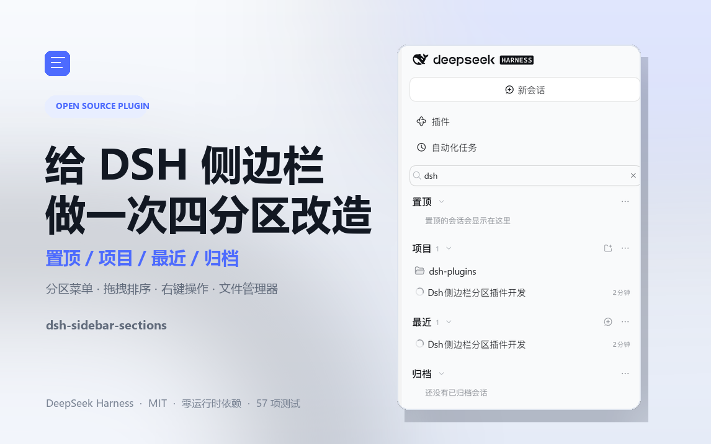

# 发布信息（复制正文时删掉这一节）

- **标题候选 1（主推）**：给 DeepSeek Harness 的侧边栏，做一次四分区改造
- **标题候选 2**：DSH 侧边栏太乱？我把它拆成了「置顶 / 项目 / 最近 / 归档」
- **标题候选 3**：从一条长列表到四个分区：我的第一个 DSH 插件开源了
- **封面**：`docs/bilibili-cover.png`（1146×717，可直接上传）
- **标签**：DeepSeek、DeepSeek Harness、DSH、开源、效率工具、AI 客户端、插件开发
- **正文配图**：`docs/screenshot.png`（多场景拼图，建议放在「现在的侧边栏长什么样」一节）
- **开源地址**：https://github.com/tzhaos/dsh-sidebar-sections

---

# 给 DeepSeek Harness 的侧边栏，做一次四分区改造

用 DeepSeek Harness（下面简称 DSH）时间一长，侧边栏就会变成一条越来越长的列表。

项目一多，会话一长，「找昨天那个对话」这件事就变得很具体：往上翻、凭记忆找项目名、再想想它是不是被归档了。置顶、最近、不同项目的会话全挤在同一列里，归档还藏在视图选项后面。DSH 本身很好用，但侧边栏这块，我一直觉得还有很大的改造空间。

所以我写了一个插件：**dsh-sidebar-sections**。它不改变 DSH 的数据和会话管理逻辑，只把侧边栏重新组织成四个分区：

> **置顶 / 项目 / 最近 / 归档**

项目已经开源，MIT 协议，零运行时依赖，目前 57 项自动化检查全部通过。



## 它到底改了什么

一句话：**把「一列会话」变成「四个抽屉」。**

- **置顶**：重要对话固定在顶部，不再和时间线抢位置
- **项目**：保留 Workspace 结构，按项目分组，可折叠
- **最近**：按活跃时间排列的对话流，找刚聊过的内容不用翻项目
- **归档**：归档对话有独立分区，不再是一个需要切换的视图

四个分区都是正式区域，不是临时过滤器。归档的对话不会混进「项目」和「最近」；取消归档或取消置顶后，它会回到该去的地方。


每个分区标题都是大号加粗的一行，右侧有折叠箭头和操作菜单。折叠状态会记住，下次打开还是你上次看到的样子。

## 分区菜单：把规则下放到每个分区

原版 DSH 的「分组方式 / 排序方式」是全局设置。但实际用起来，每个分区的诉求并不一样：

- 「项目」适合按项目分组
- 「最近」更适合直接排成一条时间线
- 「置顶」和「归档」只需要排序，不需要分组

所以插件把选择权下放到了每个分区：打开分区标题右侧的 `⋯`，可以单独设置分组方式和排序方式。选择保存在浏览器本地，不会去改宿主数据。

## 每个项目，也可以有自己的脾气

这一点是我自己用下来最需要的：

「最近」可以按最近更新排序，但某个正在推进的项目，我希望它的会话顺序**永远由我手动控制**。所以项目行也有自己的菜单，可以设置：

- 跟随分区排序（默认）
- 手动排序
- 最近更新

设置后随时可以恢复成跟随分区，不会出现「改完就回不去」的情况。

## 拖拽排序，是真正的手动顺序

切到「手动排序」后，会话行就可以直接拖动：

- 拖到另一行的上半部分 / 下半部分，会插入到它前面 / 后面
- 靠近列表边缘会自动滚动
- 真实 Workspace 分组的顺序会通过 Host API 写回，不只是本地记忆
- 写回失败会显示行内提示，而不是悄悄失败

筛选状态下不开放拖拽，避免在只看到部分行时把隐藏的会话顺序弄乱；空白草稿行也不能拖。跨项目拖动目前还不支持，这是已知限制。

## 右键，或者按 Shift+F10

会话行、项目行、分区标题都支持右键菜单，内容与 `⋯` 按钮一致。键盘用户也可以用 **ContextMenu 键 / Shift+F10** 打开同一个菜单。

项目菜单里有一个我常用的入口：**在文件管理器中打开**。点击后会调用系统默认文件管理器定位到项目目录，不模拟、不额外配置，也不绑定某个具体的编辑器。

## 搜索和归档

侧边栏顶部是全宽搜索，按会话标题、项目名或目录名过滤；匹配的项目分组会自动展开，按 `Esc` 关闭。

归档对话集中在第四个分区里：灰显、不可误打开，取消归档即可恢复。还有运行中任务时会弹出宿主原生的「停止并归档」确认，不会把正在跑的工作直接打断。

## 一些工程上的取舍

这个插件没有构建步骤，也不带任何运行时依赖。浏览器半部是一个普通脚本，只允许引用 DSH 平台模块表里的模块；图标、菜单、状态点、Modal 等全部复用宿主自带的 `ui-primitives`，颜色只用主题 token，所以亮色 / 暗色主题下都不会显得突兀。

替换侧边栏的方式是：在 `sidebar.workspaces` 这个 slot 上以优先级 `-1` 注册自己的实现，不声明任何子 slot，也不去碰宿主已有的数据。所有写操作（置顶、归档、重命名、分叉、排序）仍然走宿主 API；浏览器本地只保存视图状态。

测试是零依赖的 Node 脚本，覆盖清单、slot 注册、四个分区的数据派生、菜单、右键、拖拽、归档边界和宿主动作派发，`node scripts/check.mjs` 即可运行。

需要说明的是，DSH 的客户端 API 目前仍是 pre-stable；插件按 **0.2.1-rc.2** 的契约实现，未来版本升级后可能需要跟着调整。

## 安装

推荐通过 Harness 的 Plugin Manager 安装：

```text
plugin_manager(action="install_bundle", target="<插件目录的绝对路径>")
```

先把仓库克隆到本地，然后把 `target` 指向克隆下来的目录即可。手动 link 安装（开发用）写在 README 里。

安装后在 DSH 的插件设置里启用，侧边栏会直接切换成四分区布局；如果没生效，检查一下 profile 的 bundle 列表是否已经包含它。

## 已知限制

- 拖拽只在同一个列表 / 项目内生效，暂不支持跨项目移动
- 非真实 Workspace 分组的手动顺序只保存在浏览器本地
- 搜索只匹配已加载的标题、项目名和目录名，不是宿主消息内容搜索
- 归档分区固定显示，不提供隐藏选项
- 没有复刻原版的 Workspace 树嵌套、消息内容搜索等能力

## 最后

这个插件最初只是我为了自己顺手写的小工具，后来发现它确实改变了我每天使用 DSH 的方式：重要的事固定在顶上，项目归项目，碎片归最近，过去归归档。四个分区本身不复杂，但把「找会话」这件事变得有秩序了。

仓库在这里，欢迎试用、提 issue，或者直接告诉我你希望侧边栏下一步支持什么：

**https://github.com/tzhaos/dsh-sidebar-sections**

如果它对你有用，点个 star 就是最大的支持。也欢迎在评论区聊聊：你用 DSH 时，最想让侧边栏增加什么能力？
